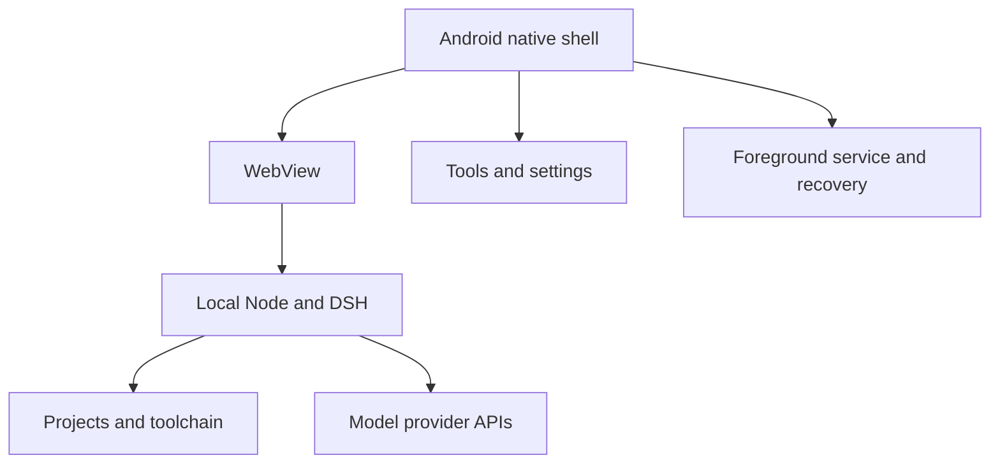

# DSH Native · DeepSeek Harness on Android

<!-- dsh-doc-status:start -->
> Maintained documentation for the current source. Published stable: **1.1.3**; source: **1.1.4**; source payload: `payload-v14`; pinned DSH: `0.2.1-rc.3` (upstream release candidate). [Current status and verification boundaries](docs/STATUS.md).
<!-- dsh-doc-status:end -->

[中文](README.md) · [English](README.en.md) · [Documentation](docs/README.md) · [Project status](docs/STATUS.md)

**Keep your project on your phone and bring the DSH workflow to Android.**

DSH Native packages Android-native Node.js, DeepSeek Harness (DSH), and development tools into an Android application. Chat, run agents, edit files, and manage tasks in local projects without installing Termux or proot or setting up a remote execution server.

Model inference uses your selected provider's API. Project storage and tool execution are local; messages, attachments, and tool results are transmitted according to DSH and the provider's request behavior. This is an independent Android adaptation project.

Version 0.34.0 upgrades the core to DSH 0.2.1-rc.3 and audits existing mobile layouts, native dialogs and draft integration. See [release notes](release-notes/v0.34.0.md) for changes and validation boundaries.

0.34.1 fixes the runtime manifest size limit; users whose core update failed on 0.34.0 can install the fixed APK over the existing App and retry.

0.34.2 repairs upgrade remnants that shadow skill/team dependencies, accepts old account catalog caches while using the authenticated live listing, and supplies the Android runtime flag to the inspector Worker. Install over the existing App and restart the core; configuration and history are retained.

0.35.0 repairs notification task status, adds Android system dictation to the existing voice plugin, and fixes tool commands, temporary directories and new files on shared storage. Install over the existing App and restart the core, then enable the voice plugin and check the system speech service. Dictation only fills the draft. See [voice and status troubleshooting](docs/VOICE_INPUT.md) and the [environment guide review](docs/ENVIRONMENT_UPGRADE.md) (Chinese). System speech support depends on the installed engine; device testing remains with the user.

0.35.1 adds the missing compatibility fallback for immediate speech error 5: it checks the selected default engine, tries the system speech window after startup failure, and prevents premature or duplicate stop calls. Install over the existing App and restart the core. A compatible installed system speech interface is still required.

0.36.0 integrates voice interaction into the DSH composer with themed controls, real audio levels, elapsed time and interim text previews. It connects to public recognition services and offers engine selection in plugin settings. It no longer opens a system speech window automatically; phones exposing only that interface retain an explicit “Use system voice” action. Restart the core after installing.

0.36.1 waits for stable foreground window focus after microphone permission returns and checks permission again before recording. Transient pre-recording service errors retry at most once. The in-page voice panel remains; install over the existing App and restart the core. No microphone warmup is needed.

0.36.2 handles whitespace after shebang markers in managed Python scripts and checks actual file-tool creation, reading, collision protection and versioned updates in the private runtime and selected workspace. Startup diagnostics also report optional Python imports. Install over the existing App and restart the core.

0.37.0 adds an actual Android tool and dsh-android CLI for clipboard text, notifications, share sheets, opening links/files/apps, keepalive status and a one-shot screenshot with fresh system consent. Restart the core after installing. See the [native capability guide](docs/ANDROID_BRIDGE.md) (Chinese).

0.37.1 isolates late capture consent callbacks, returns images after service resource cleanup, and removes completed timers. It also handles rotation, allocation failure and truncated frames. Install over the existing App and restart the core; existing native tools remain available.

0.37.2 rechecks the project and window before opening a prepared file. Native actions now report system denial, missing activity handlers, unavailable notification channels and UI timeouts explicitly. Cancellation and service shutdown remove queued actions, including capture authorization startup races. Install over the existing App and restart the core.

1.1.2 shortens the startup critical path by moving full tool/Python/network inspection after the homepage handoff, reusing verified preparation, and cancelling inspection for chat or restart. Failed optional checks no longer block reuse. See [release notes](release-notes/v1.1.2.md); device timing remains subject to user testing.

1.1.3 gives the startup whale a more lively swim, independent tail movement, occasional blinks and rising bubbles, with a brand title and short readiness-driven transition. Landscape, large text and background pausing are handled by the same native scene. See [release notes](release-notes/v1.1.3.md).

1.1.4 stages up to three runtime shards concurrently and remembers a working download source. A live prepared core avoids repeated disk verification and HTTP probes, while page restoration precedes optional maintenance. Update checks, cached APK cleanup and tool inspection wait until at least five quiet seconds after the homepage handoff or foreground return. Recovery error detection processes changed nodes instead of repeatedly reading the whole page. See [release notes](release-notes/v1.1.4.md); actual phone timing still needs user testing.

<!-- project-navigation:start -->

Stable 1.0.0 completes six readiness stages and the additional startup/catalog feedback checks. Model catalogs apply in the current core, long lists support touch scrolling, verified preparation is reused after process exit, and the brand whale keeps a quieter loading motion. See the [acceptance record](docs/RELEASE_1_0.md), [privacy](docs/PRIVACY.md), [third-party sources](docs/THIRD_PARTY.md) and [troubleshooting](docs/TROUBLESHOOTING.md). Install over the existing app; device acceptance remains with the user.

0.40.0 improves loopback recovery after background/screen-off returns without reloading chat or replaying prompts. The separate App tools button is removed; device controls use the original settings entry. Settings clicks survive background refreshes, while CodeBuddy prepares quick follow-ups and avoids retransmitting historical assistant reasoning. Install over the current app and restart the core; device validation remains with the user.

## Project overview

| Item | Details |
| --- | --- |
| Category | Android AI workbench |
| Platform | Android / ARM64 / native runtime |
| Role | Independent Android adaptation of DeepSeek Harness |

Startup pairs a larger brand whale with independent tail movement, occasional blinks, rising bubbles and clear status text in both themes. Once the core connection and rendered shell are ready, a 180ms transition opens the page without waiting for a full animation loop. Reduced motion opens it immediately. Prepared background cores are reused early; updates retain real preparation status.

For installation, use the download and setup sections below. Source, release and validation facts are maintained in [STATUS](docs/STATUS.md).
[Codex Harness Mobile](https://github.com/yusheng266186-beep/codex-harness-mobile) uses a separate Termux / Debian environment.
[All public projects](https://github.com/yusheng266186-beep)

<!-- project-navigation:end -->

## Download and requirements

**Current stable release: 1.1.3**

**[Download DSHNative-bootstrap.apk](https://github.com/yusheng266186-beep/DSH-Native/releases/download/v1.1.3-bootstrap/DSHNative-bootstrap.apk)** (41.4 MiB)

[Release notes](https://github.com/yusheng266186-beep/DSH-Native/releases/tag/v1.1.3-bootstrap) · [All releases](https://github.com/yusheng266186-beep/DSH-Native/releases)

SHA-256: `6b05dbe2f52ab4ebe8ff435001f46bef589e7fb7949967839512258484b894d2`

| Item | Requirement or behavior |
|---|---|
| Android | Android 7.0 or later; minSdk 24 |
| CPU | ARM64; no ARM32 or x86 package is currently provided |
| First launch | Downloads a roughly 143.7 MiB runtime; later updates download changed parts |
| Storage | Allow room for extraction, downloads, and rollback snapshots; reserve 1.5–2 GiB and follow the App's actual space check |
| Model access | CodeBuddy API key, DeepSeek API key, or DeepSeek account authorization; models and quotas depend on your account |
| Background tasks | Allow notifications and background operation as appropriate for your device; a foreground service cannot prevent every ROM from terminating the process |

The APK carries Node and bootstrap logic. DSH and the toolchain are installed from runtime parts verified by hash. Extracted storage is considerably larger than compressed downloads, and safe updates require additional snapshot space.

**Upgrade by installing the same-signed new APK over the existing App.** Uninstalling removes private sessions, credentials, and settings. A configuration backup does not back up all projects or conversation history.

## From installation to your first task

1. Install the APK and grant the requested file and notification permissions.
2. Select a language and complete runtime download, SHA-256 verification, and extraction.
3. Import a private encrypted CodeBuddy CLI connection in DSH Models, enter a CodeBuddy / DeepSeek key, or authorize DeepSeek from the original Account section.
4. Fetch the provider's live model directory, choose a default model and effort, and save.
5. Use the default workspace or create a named project, then start a new conversation.

Choose language and theme in DSH General settings. App settings shares its navigation, theme and language; device tools use the current language when opened. App Display settings controls text scale. Existing installations with `.dsh` data are not forced through first-run onboarding again.

### Finding App tools

Expand the DSH sidebar and select **App tools** at the bottom to open **App settings** inside DSH settings. **Models** opens provider tools with **Refresh models**. **DeepSeek account, balances & usage** opens DSH’s original **Account** section.

Fallback entry points include a long press on the top of the page, the notification's settings action, and launcher shortcuts for settings, logs, and updates. The web gear continues to open DSH's own settings.

Visible back buttons, the Android back button, and edge gestures follow the same parent navigation in native subpages.

## Workflows and capabilities

| Workflow | Current capabilities |
|---|---|
| Local agent | DSH and Android/bionic Node in the private App directory, with git, rg, fd, jq, bash, Python, and other tools |
| Models | Live provider catalog, global defaults, project overrides, per-model effort, and a Max request option for every model |
| Projects and files | Named projects, file browsing and text editing, image preview, batch copy/move, recoverable trash |
| Share import | Import text or files from other Apps into the current project and explicitly create a task |
| Tasks and connection | Task center, timeline, approval alerts, background completion notifications, WebSocket status, local draft recovery |
| Conversations | Real list, title filter, pagination, rename, archive, restore and continue, recoverable deletion |
| Maintenance | App/runtime updates, runtime snapshots and recovery, network diagnostics, logs, redacted diagnostic ZIP |
| Configuration backup | Authenticated encryption with a password of at least eight characters; includes credentials, the active Web profile, and global/project model settings |
| Plugins | Built-in management and external installation, with capability disclosure and version-fingerprint authorization |

### Models come from your provider account

| Route | Directory endpoint | Behavior |
|---|---|---|
| CodeBuddy CLI | Official SDK 0.3.291 / CLI 2.176.0 | Bundled phone-local CLI agent; catalog snapshots do not establish account access |
| Direct DeepSeek | `GET https://api.deepseek.com/models` | Directory returned for your official API key |
| DeepSeek account | Core `account/*` and `session/modelCatalog` | Core-managed account model route after browser authorization |

DSH’s original account page shows account details, topped-up and granted balances, usage, top-up and sign-out actions. Sign-in opens DeepSeek's authorization page in your browser. After authorization, return to the App, choose **DeepSeek account**, fetch the model list, and save. You can reopen authorization, cancel a pending attempt, or sign out. API keys and account authorization are stored separately. Signing out stops tasks using that account and retains API keys, sessions, and projects. See [account integration and verification boundaries](docs/DEEPSEEK_ACCOUNT.md).

DeepSeek checks read its live directory. CodeBuddy chat uses the bundled official CLI agent. Check connection sends a short request and may use a small amount of quota; catalog refresh reads pinned metadata without claiming chat or account authorization. Import your private CLI connection file in Models; the key is stored through DSH credentials. See [CodeBuddy import](docs/CODEBUDDY.md).

New IDs remain selectable even when absent from the local capability snapshot. Structured upstream declarations take priority for image support, followed by existing configuration. Unknown capability is not labeled as image support. Saved settings can be retained during temporary offline operation; initial setup or choosing a new model requires a successful live fetch.

**Refresh models** writes the DeepSeek live directory or pinned CodeBuddy CLI metadata directly to DSH's provider configuration. A controlled runtime reload applies them when idle, followed by a page refresh. Running or unknown task state defers application until confirmed idle. Reloading WebView alone cannot rebuild the provider topology.

Global and project defaults apply to new conversations. Existing history is retained; the chat model picker can explicitly change the model or effort for subsequent requests. Already dispatched requests are not changed retrospectively.

### Effort: provider declarations and Max requests

The App retains declared levels such as `off`, `minimal`, `low`, `medium`, `high`, and `xhigh`, and adds a literal `max` request option to **every model**. The composer labels it **Max (request)**.

| Example | Pinned capability declaration | Options offered by the App |
|---|---|---|
| Space Bunny `stealth/space-bunny-alpha` | low / medium / high | Declared levels + Max (request) |
| `Qwen/Qwen3.8-Max` | low / medium / xhigh | Declared levels + Max (request) |
| Automatic, non-adjustable, or unknown models | No reliable adjustable-effort declaration | Provider default (omit the parameter) + Max (request) |
| Direct DeepSeek | off / low / high / max | Existing levels, with literal max transmitted |

**Selecting max means the client submits that parameter; it does not guarantee a larger reasoning budget.** A provider may honor, ignore, or reject it. The App does not silently downgrade to high or present the option as proven model capability.

See [Model reasoning](docs/MODEL_REASONING.md) for the complete table, provenance, precedence, migration behavior, and test boundaries.

### Projects, files, and conversations

The default workspace is `/sdcard/DSHNative/workspace`; named projects live under `projects/<name>` and can have their own model defaults.

File writes are restricted by canonical-path allowlists. Directory copies do not follow symlinks. Deletion normally moves files to same-volume trash; restoration preserves both copies when a name conflicts. Text editing includes unsaved-change handling and safe save behavior.

Draft recovery restores local text without sending it. **App settings → Sessions** can rename, archive, restore and continue, or move a conversation to Trash. Trashed records are hidden from the sidebar and search and can be restored. They retain storage. Stop active or queued work before archiving or deletion. Original DSH title/workspace search remains available. Content search is opt-in upstream and disabled by default.

Configuration restoration stops DSH before writing and restarts it to apply the result. Plugins has an explicit Apply & restart action. Configuration backup excludes full workspaces, complete history, and attachments; back up project files separately.

### Updates and recovery

Model Center keeps the selected provider’s refresh progress, model count, or error visible. Failed requests preserve the existing catalog. The chat catalog applies when DSH is idle; save separately to change the default model.


| Operation | Scope |
|---|---|
| App update | Verify version, package, signature, and checksum, then invoke Android's installer |
| Runtime update | Verify parts and replace changed DSH/toolchain content |
| Restore previous runtime | Verify and restore `dsh` / `tools` snapshots while retaining `.dsh` and projects; no APK downgrade |
| Export diagnostics | Device, layout, connection, runtime, rollback summaries, and redacted logs; excludes keys, conversation content, attachments, and project files |

Stable clients read `latest.json`. Test-channel clients compare it with `latest-test.json` and select the higher version. Each published manifest stays bound to its own APK and payload.

Runtime updates check space and take a snapshot before replacement, with recovery on failure. Automatic recovery holds further updates to avoid a startup loop. The pinned core version and its upstream release status are recorded in [STATUS](docs/STATUS.md); the App's stable channel is independent of that upstream designation.

## Data and permission boundaries

- Credentials live in private `.dsh/.credentials.yaml`; model settings also involve profile patches and project overrides.
- Logs and diagnostics redact secrets; catalog response bodies and authentication headers are not logged.
- Web assistance uses restricted injection and message handling, without a high-privilege `JavascriptInterface`.
- File operations are limited to the private App directory and `/sdcard/DSHNative`, with canonical-path and symlink escape checks.
- External plugins execute in the local tool environment; review their disclosed capabilities before authorization.
- The App provides neither root privileges nor a full Linux distribution. Model inference requires your provider to be available.

## Architecture



Two-stage delivery separates the APK from the larger runtime. Node, libraries, bootstrap scripts, and an initial manifest ship in the APK. Runtime parts contain DSH and tools, with revisions, sentinels, sizes, and SHA-256 used for update decisions.

Logic for path safety, model capability, update decisions, task status, and recovery is separated from Android UI and tested on a normal JVM. Native views use `DshUi`; asynchronous callbacks validate lifecycle state. Theme-driven recreation uses debouncing, persistent rate limiting, and a hard stop.

The current architecture keeps `targetSdk 28` because executables run from private App storage. Raising it requires redesigning executable deployment rather than changing a routine release setting.

## Development and verification

Local checks require a JDK, Python 3, and Node.js. Complete Linux builds additionally need Android SDK, GitHub CLI, and access to a previous stable APK.

```bash
python3 scripts/check_java.py
bash scripts/run_tests.sh
python3 scripts/sync_project_metadata.py --check --allow-unpublished-source

# Linux with Android SDK already installed
bash scripts/ci_build.sh /tmp/dsh-build
```

The output is `/tmp/dsh-build/bootstrap/DSHNative-bootstrap.apk`. Actions uses JDK 17, official Linux build-tools 34.0.0, and Android 28/34 platform files. See [Build guide](docs/BUILD.md).

Regression covers JVM logic, JS page/connection simulations, local HTTP authentication, release metadata, and the actual runtime's Host, model catalogs, SDK request bodies, session persistence, and Web profile. Composer tests run the real React selector for both locales and verify model/max RPCs. Test counts are taken from the current CI output.

Real-payload tests also measure send, attachment, file-tab close and settings controls in touch Chromium across six width/orientation/language/theme scenarios. See the [layout handover](docs/HANDOVER-LAYOUT.md) for reproduction and verification boundaries.

These checks do not prove Android device layout, providers' real execution of max, or background reliability across every ROM. Evidence and remaining verification are recorded in [Project status](docs/STATUS.md).

### Documentation is part of release synchronization

```bash
python3 scripts/sync_project_metadata.py --docs-only
python3 scripts/sync_project_metadata.py --docs-only --check
```

After release assets and download routes are verified, `release.yml` / `release.sh` generates manifests and synchronizes both READMEs, every document's status block, and the current status table. Historical iteration content is retained. Do not edit generated blocks manually. Source can lead the published release, but documentation must show both accurately.

## Repository map

| Path | Responsibility |
|---|---|
| `src/dev/dsh/nativeapp/` | Native shell, pure logic, panels, foreground service |
| `payload/` | Download, extraction, preflight, snapshots, runtime helpers |
| `runtime/` | Pinned core source, integrity, dependency lock |
| `patch/` | Android compatibility notes and explicitly archived patches |
| `tests/` | Java, JS, HTTP, and actual-runtime consumer regression |
| `scripts/` | Build, signing, releases, payload generation, documentation sync |
| `docs/` | Current guides, status, handover, historical phases and research |
| `release-notes/` | Separate version-specific App and payload changes |

Start with [Documentation](docs/README.md). Before development, read [AGENTS.md](AGENTS.md), [Handover](docs/HANDOVER.md), and [Gotchas](docs/GOTCHAS.md).

## Limits and provenance

ARM64 only; first initialization requires network access; Android and ROM policies constrain background operation; unknown image capability is not guessed. A large Office-to-PDF engine is not bundled. Runtime restoration covers DSH/tools, not APK downgrade or full data recovery.

Repository code is licensed under [MIT](LICENSE). DSH, Node.js, Termux-origin binaries, and other bundled components retain their own licenses; the repository license does not relicense all dependencies.

- [DeepSeek Harness upstream](https://github.com/deepseek-ai/deepseek-harness)
- [Termux](https://github.com/termux/termux-app)
- [Pinned core and upgrade notes](docs/CORE_UPGRADE.md)
- [Android 10 behavior changes](https://developer.android.com/about/versions/10/behavior-changes-10)

Device controls now live in the DSH settings navigation. File previews and delivery cards offer editing, Android open-in-app and system sharing. External editing grants write access only after an explicit Edit action and requires a compatible content-URI editor. See [file actions](docs/FILE_ACTIONS.md) and [CodeBuddy import](docs/CODEBUDDY.md).

[1.1 architecture refactor and verification / 架构重构与验证](docs/REFACTOR_1_1.md)。
